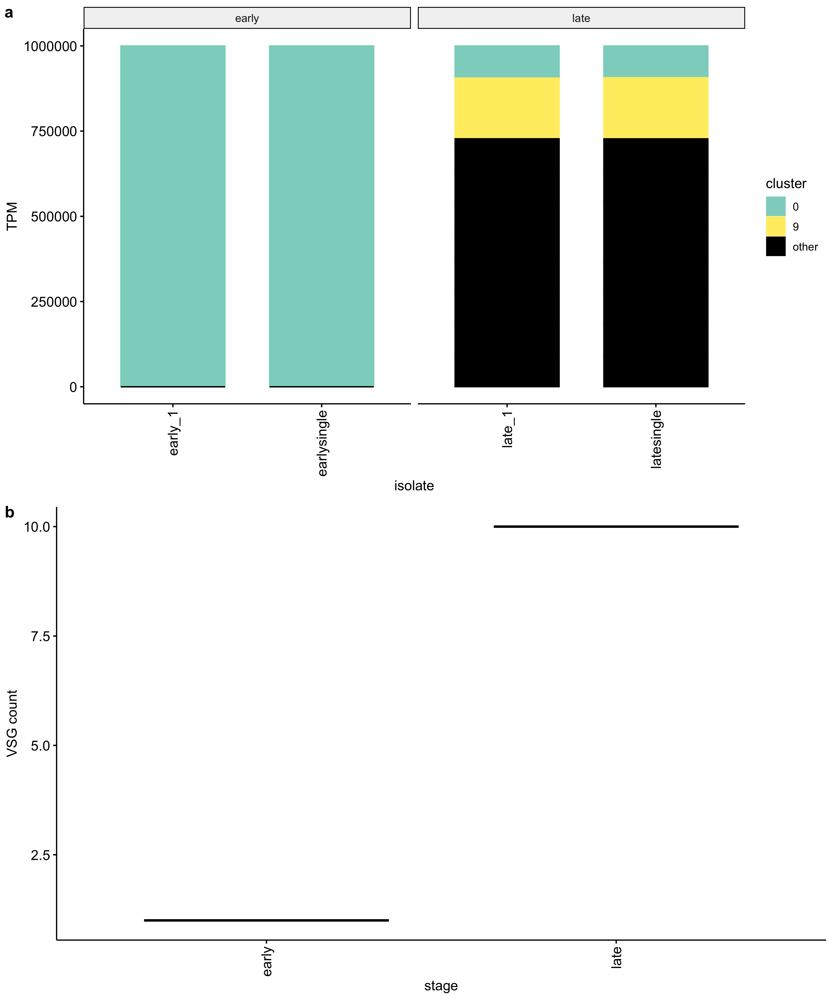
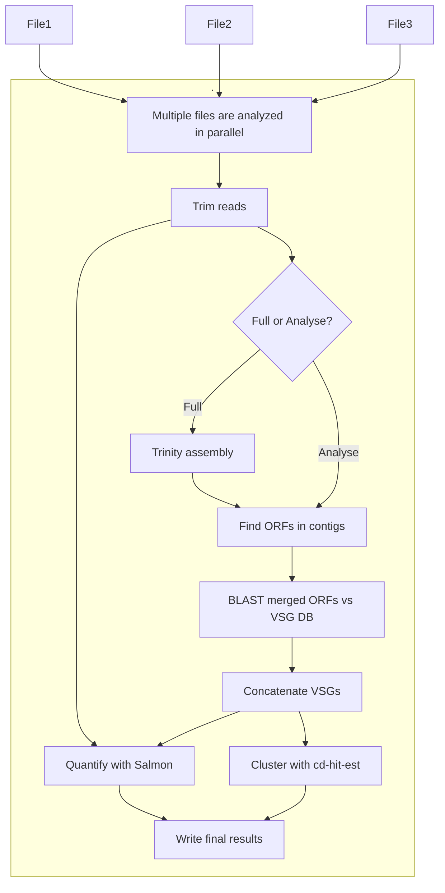

# vsgseq2

[](https://github.com/goldrieve/vsgseq2/actions/workflows/ci.yml)
[](https://github.com/goldrieve/vsgseq2/actions/workflows/lint.yml)

**vsgseq2** is an updated pipeline for analysing VSG-seq data, based on the original VSGSeq pipeline described in [this paper](https://www.ncbi.nlm.nih.gov/pmc/articles/PMC4514441/) and [repository](https://github.com/mugnierlab/VSGSeqPipeline).

## Installation

This pipeline is built using [Nextflow](https://www.nextflow.io/) and requires Nextflow 26.04.0 or later. Nextflow can be installed via Conda like this:

```bash
conda create --name nf-env "bioconda::nextflow>=26.04.0"
conda activate nf-env
```

### Download test data

You will require `wget`, which can be installed using your OS-specific package manager or Conda, e.g.:

    conda install -n nf-env anaconda::wget

```bash
wget https://github.com/goldrieve/vsgseq2/raw/refs/heads/main/data/reads.tar.xz
tar -xf reads.tar.xz
cd reads
```

Run vsgseq2 on test data with Conda:

```bash
nextflow run goldrieve/vsgseq2 \
  -r main \
  --samplesheet samples.csv \
  --outdir results \
  -profile conda
```

### Profiles

Choose how software is provided with `-profile`:

| Profile       | Software                                                                    | Cache directory                                     |
| ------------- | --------------------------------------------------------------------------- | --------------------------------------------------- |
| `conda`       | One Conda environment per module (`modules/local/<module>/environment.yml`) | `conda-cache/` or `$NXF_CONDA_CACHEDIR`             |
| `docker`      | One container per module                                                    | Docker's own image store                            |
| `singularity` | One container per module                                                    | `singularity-cache/` or `$NXF_SINGULARITY_CACHEDIR` |
| `apptainer`   | One container per module                                                    | `apptainer-cache/` or `$NXF_APPTAINER_CACHEDIR`     |

Environments and images are created on first use and reused on later runs. Set the matching `NXF_*_CACHEDIR` variable to share a cache between projects. We recommend containers where available, as they give identical software on every system.

If you run with `-profile conda` from a shell with a Python virtual environment active, deactivate it first. Otherwise its `python` can take priority over the module environments.

### Samplesheet

The samplesheet is a CSV with the columns `sample`, `r1` and `r2`. Leave `r2` empty for single-end reads. Sample names must be unique and cannot contain spaces or full stops. See `assets/samplesheet.csv`.

```csv
sample,r1,r2
early_1,early_1_1.fastq.gz,early_1_2.fastq.gz
latesingle,latesingle.fq.gz,
```

### Test profile

From a clone of the repository, run the bundled test data with:

```bash
nextflow run main.nf -profile test,conda --outdir results/test
```

The `test` profile uses two small samples from `tests/data` (one paired-end, one single-end) and limits each task to 2 CPUs and 15 GB of memory. Swap `conda` for `docker`, `singularity` or `apptainer` to test containers.

## Example Output

After running the tutorial data, output files are organised into the following directories:

### 1. `VSGs/`

- `{sample}_ORF_VSGs.fasta` – Predicted VSG ORF sequences per sample
- `concatenated_vsgs.fasta` – All assembled VSGs from all samples
- `VSGome/`

  - `VSGome.fasta` – Clustered VSG database using cd-hit-est
  - `VSGome.fasta.clstr` – Summary of clustering results

### 2. `assemblies/`

- `{sample}_trinity.Trinity.fasta` – De novo transcriptome assemblies

### 3. `summary/`

- `cluster/`

  - `filtered_tpm_clusters.csv` – TPM values with cluster assignments
  - `filtered_tpm_clusters_length.csv` – As above with sequence lengths
  - `cluster_champion.csv` – Representative VSGs per cluster
  - `champion_vsgs.fasta` – Sequences of representative VSGs

- `length/`

  - `length.csv` – Sequence length data

- `multiqc_report.html` – Summary of quantification (Salmon)
- `multiqc_data/` – MultiQC data files
- `read_counts/`

  - `num_reads.csv` – Read counts per VSG
  - `total_read_counts.csv` – Total reads per sample

- `tpm/`

  - `tpm.csv` – Raw TPM values
  - `filtered_tpm.csv` – TPM values filtered by read threshold
  - `cluster_tpm.csv` – Cluster-level TPMs

- `vsgs/`

  - `vsg_count.csv` – Number of unique VSGs per sample

### 4. `trimmed/`

- `{sample}_trimmed.fq.gz` (single-end) or `{sample}_trimmed_1.fq.gz` and `{sample}_trimmed_2.fq.gz` (paired-end) – Quality-trimmed reads

### 5. `pipeline_info/`

- Execution report, timeline, trace, DAG and software versions

### 6. Figures

- To generate a summary figure from `cluster_tpm.csv`, run the R script `bin/plot_script.R`. It should produce this plot:



## Pipeline Overview

Below is a simplified DAG of the vsgseq2 pipeline:



## Running Specific Pipeline Sections

Use the `--mode` flag to control which parts of the pipeline are executed.

- `full` (default): Run the entire pipeline from raw reads
- `analyse`: Use pre-assembled transcripts to rerun downstream analyses

In `analyse` mode, Trinity is skipped and ORFs are predicted from the files matched by `--assemblies`. The sample name is taken from each file name by removing `_trinity.Trinity.fasta`, so assemblies from a previous run (`<outdir>/assemblies/`) can be reused directly. The samplesheet is still required, because reads are trimmed and quantified against the new VSGome.

### Example

Run the full pipeline:

```bash
nextflow run goldrieve/vsgseq2 \
  -r main \
  --mode full \
  --samplesheet samples.csv \
  --outdir results \
  -profile conda
```

Re-use Trinity assemblies and re-run the analysis section with a new threshold:

```bash
nextflow run goldrieve/vsgseq2 \
  -r main \
  --mode analyse \
  --assemblies 'results/assemblies/*_trinity.Trinity.fasta' \
  --samplesheet samples.csv \
  --threshold 200000 \
  --outdir results/tutorial_200000 \
  -profile conda
```

## Command-line Options

Run `nextflow run goldrieve/vsgseq2 --help` for all options.

**Input/output:**

```text
--samplesheet     Samplesheet CSV (sample,r1,r2)                    [required]
--outdir          Output directory                                  [default: results/<today>]
--mode            full or analyse                                   [default: full]
--assemblies      Assemblies used in analyse mode                   [default: data/tutorial_assemblies/*_trinity.Trinity.fasta]
```

**References:**

```text
--vsg_db          VSG BLAST database                                [default: data/blastdb/concatAnTattb427.fa]
--notvsg_db       Non-VSG BLAST database                            [default: data/blastdb/vsgseq2NOTvsgs.fa]
--full_vsg_db     Additional VSGs to add to the VSGome              [default: none]
--genome          Genome used as Salmon decoys                      [default: data/genome/TriTrypDB-67_TbruceiEATRO1125_Genome.fasta]
--decoys          Salmon decoy names                                [default: data/genome/TriTrypDB-67_TbruceiEATRO1125_Genome_decoys.txt]
```

**Analysis:**

```text
--cdslength       Minimum ORF length (aa)                           [default: 300]
--partial         Allow partial ORFs                                [default: false]
--cdhit_id        cd-hit-est identity threshold (0-1)               [default: 0.94]
--cdhit_as        cd-hit-est alignment coverage (0-1)               [default: 0.94]
--threshold       Minimum reads to keep a sample in the TPM filter  [default: 100000]
```

**Resources:**

```text
--cores           Threads for Trimmomatic, Trinity and Salmon       [default: 4]
--trinitymem      Memory for Trinity (GB)                           [default: 20]
--forks           Maximum parallel tasks per process                [default: 5]
```

## Resources: cores, memory and forks

Three parameters control how much of your machine or cluster vsgseq2 uses.

| Parameter      | Applies to                      | Effect                                                              |
| -------------- | ------------------------------- | ------------------------------------------------------------------- |
| `--cores`      | TRIM, ASSEMBLE, INDEX, QUANTIFY | Threads per task. All other steps are single-threaded.              |
| `--trinitymem` | ASSEMBLE                        | Memory per Trinity task in GB, passed to Trinity as `--max_memory`. |
| `--forks`      | Every step                      | Maximum number of tasks of the same step running at once.           |

The other steps request a fixed amount of memory, which doubles if a task is retried after running out of memory:

| Steps                                                                | Memory (first attempt) |
| -------------------------------------------------------------------- | ---------------------- |
| TRIM, INDEX, QUANTIFY                                                | 12 GB                  |
| ORF, BLAST, CONCATENATE_VSGS, CONCATENATED_CDHIT, MULTIQC, SUMMARISE | 6 GB                   |

To cap every request at what your machine or queue allows, set `process.resourceLimits` in a config file passed with `-c`:

```groovy
process.resourceLimits = [ cpus: 8, memory: 16.GB, time: 24.h ]
```

`--forks` is a per-step limit, not a pipeline-wide one, so different steps can overlap. For example, ASSEMBLE can run on one sample while TRIM runs on another. While Trinity is assembling, the peak use is roughly:

- CPUs: `forks × cores`
- Memory: `forks × trinitymem` GB

With the defaults (`--cores 4 --trinitymem 20 --forks 5`), that is up to 20 CPUs and 100 GB. Choose values that fit your machine:

| Machine                       | Suggested settings                     | Peak during assembly   |
| ----------------------------- | -------------------------------------- | ---------------------- |
| Laptop (8 CPUs, 16 GB)        | `--cores 4 --trinitymem 10 --forks 1`  | 4 CPUs, 10 GB          |
| Workstation (32 CPUs, 128 GB) | `--cores 8 --trinitymem 20 --forks 4`  | 32 CPUs, 80 GB         |
| HPC cluster                   | `--cores 8 --trinitymem 40 --forks 20` | Per job: 8 CPUs, 40 GB |

When running locally, Nextflow also never starts more tasks than the machine has CPUs, and stops with an error if a task requests more memory than is available, so set `process.resourceLimits` on machines with less than 12 GB. On a cluster, each task is submitted as a separate job with the requested CPUs and memory, and `--forks` limits how many jobs of each step are queued at once. Pass your scheduler settings in a config file with `-c`, for example:

```groovy
// cluster.config
process.executor = 'slurm'
process.queue    = 'standard'
```

```bash
nextflow run goldrieve/vsgseq2 -profile apptainer -c cluster.config --samplesheet samples.csv --cores 8 --trinitymem 40 --forks 20
```

## Pipeline structure

vsgseq2 follows the nf-core template:

```text
main.nf                    entry point
workflows/vsgseq2.nf       main workflow
subworkflows/              initialisation, validation and completion
modules/local/<module>/    one process per module, with environment.yml and nf-test
conf/                      base resources, module options and the test profile
assets/schema_input.json   samplesheet schema
nextflow_schema.json       parameter schema
bin/                       helper scripts used by the modules
tests/                     integration test and test data
```

## Known Issues & Troubleshooting

1. **Platform Compatibility**:
   vsgseq2 has been tested on:

   - **Eddie (University of Edinburgh cluster)** running Rocky Linux 9
   - **MARS (University of Glasgow cluster) running Rocky Linux 8.10**
   - **MacOS Sequoia (Apple M1)**
   - **MacOS Sequoia (Intel)**

If you have Conda/Docker installed, it should work on most systems. If you encounter issues, please raise an issue or get in touch.

2. **Memory Usage (Trinity)**:
   Trinity is memory-hungry. If vsgseq2 stalls or is killed during assembly, run fewer assemblies at once and give each less memory:

   ```bash
   --cores 2 --trinitymem 10 --forks 1
   ```

   See [Resources: cores, memory and forks](#resources-cores-memory-and-forks).

3. **Resuming a run**:
   Add `-resume` to the same command to reuse completed steps after an error or a change of downstream parameters such as `--threshold`.
